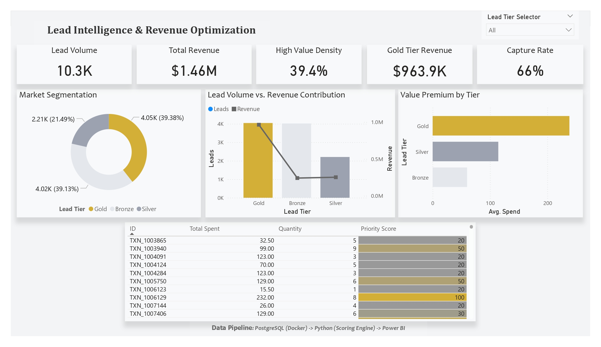

# Lead Intelligence & Revenue Optimization Engine


### 📊 Project Overview
A retailer's sales log treats every transaction the same, so the team can't see where the revenue really comes from. This end-to-end pipeline cleans the data, loads it into PostgreSQL, scores every transaction with a Python rules engine, and visualises the result in Power BI, so the team knows which activity to prioritise.

**Dataset:** 12,575 retail transactions (Jan 2022 – Jan 2025) from 25 customers across 8 categories (patisserie, milk products, butchers, beverages, food, furniture, household electricals, computers), split roughly evenly between online and in-store.

### 🚀 Key Results
| Tier | Transactions | Share of transactions | Revenue | Share of revenue | Avg. spend |
|---|---|---|---|---|---|
| Gold | 4,045 | 33.8% | $963.9K | 62.1% | $238 |
| Silver | 2,207 | 18.4% | $252.5K | 16.3% | $114 |
| Bronze | 5,719 | 47.8% | $335.7K | 21.6% | $59 |
| **Total** | **11,971** | | **$1.55M** | | $130 |

**The finding:** about a third of transactions (Gold) drive about 62% of revenue. A team that focuses on Gold-type purchases covers most of the revenue while spending far less effort on the low-value half.

### 🛠️ Tech Stack
* **Database:** PostgreSQL 18.3, run with Docker (`docker-compose.yml`)
* **ETL and scoring:** Python 3 (Pandas, SQLAlchemy, Psycopg2)
* **Visualisation:** Power BI Desktop

### 🧠 Methodology
**1. Cleaning (`cleaner.py`), 12,575 → 11,971 rows**
* Standardised column names and parsed dates
* Rebuilt missing `Price_Per_Unit` or `Total_Spent` from the other two values (price × quantity = total)
* Dropped rows still missing an ID, customer or total spend
* Filled missing item and category names; treated a missing discount flag as "no discount"

**2. Loading (`database_loader.py`):** writes the clean data to a `leads` table in PostgreSQL.

**3. Scoring (`enricher.py`):** each transaction gets a rule-based score out of 100:

| Rule | Points |
|---|---|
| Total spend above the average transaction ($129.65) | +50 |
| More than 5 items | +30 |
| Paid full price (no discount applied) | +20 |

Tiers: **Gold** = above 70 · **Silver** = 31–70 · **Bronze** = 0–30. Results are saved to an `enriched_leads` table.

**4. Export (`exporter.py`):** exports every scored transaction to `data/final_gold_leads.csv` for Power BI.

### ⚠️ Limitations and Next Steps
* **Transactions, not customers.** Each row is a purchase, and there are only 25 customers. The next version would aggregate to customer level (recency, frequency and spend) so the output is a true list of customers to prioritise.
* **Hand-set weights.** The 50 / 30 / 20 points are judgement calls. A better approach would learn weights from outcomes, for example which customers bought again.
* **Missing discount data.** 4,199 raw rows (about a third) had no discount flag and were treated as full price, which may overstate their scores.
* **Bug fixed (v2):** in the first version, transactions scoring 0 fell outside the tier bands and were left untiered, so 1,700 transactions (14%, $94.5K) were missing from the totals. v1 reported $1.46M total revenue, a 39.4% Gold share and 66% revenue capture; the figures above include every transaction.

### 📂 Project Structure
```bash
.
├── data/
│   ├── raw_leads.csv           # Original transactions
│   ├── cleaned_leads.csv       # Output of cleaner.py
│   └── final_gold_leads.csv    # All scored transactions, for Power BI
├── scripts/
│   ├── cleaner.py              # Cleaning and imputation
│   ├── database_loader.py      # Loads clean data into PostgreSQL
│   ├── enricher.py             # Rule-based scoring and tiers
│   ├── exporter.py             # PostgreSQL to CSV
│   └── config.py.example       # Template for DB credentials
├── docker-compose.yml          # PostgreSQL 18 in Docker
├── dashboard.png
└── README.md
```

### 🔁 How to Reproduce
1. Clone: `git clone https://github.com/Jows1/lead-intelligence-engine.git`
2. Configure: copy `scripts/config.py.example` to `scripts/config.py` and add your credentials
3. Start the database: `docker-compose up -d` (PostgreSQL on localhost:5433)
4. Run the pipeline in order, from the project root:
   `python scripts/cleaner.py` → `python scripts/database_loader.py` → `python scripts/enricher.py` → `python scripts/exporter.py`
5. Import `data/final_gold_leads.csv` into Power BI
